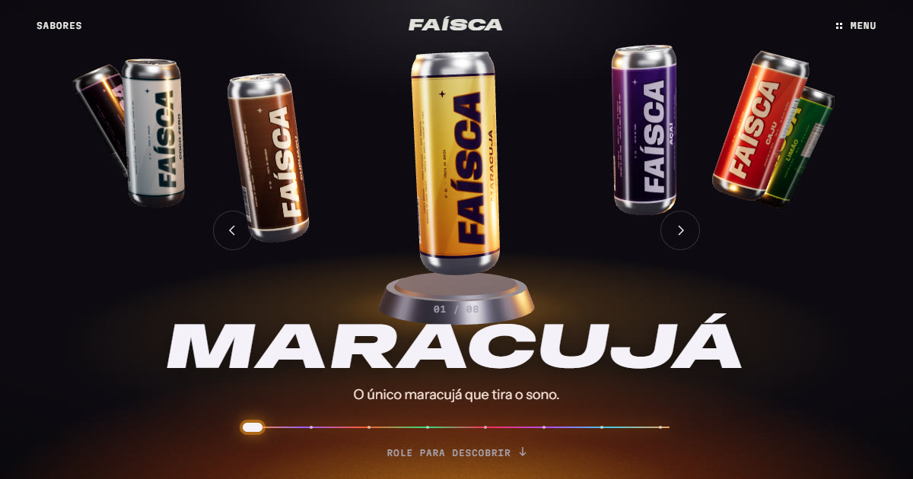

# Faísca Energia

Site conceito de um energético feito com frutas brasileiras. A ideia veio dos vídeos "Websites in 2026": latas em 3D, uma lata que gira conforme a rolagem, tinta líquida que revela a polpa da fruta e uma assistente com cabeça de TV.

**Ver o site:** https://sah123campos.github.io/faisca/



## O que tem na página

- **Sabores:** carrossel 3D com 8 latas. Dá para arrastar, usar as setas, as setas do teclado ou a barra colorida.
- **A lata:** ao rolar, a lata gira e acende cada item do rótulo (menos açúcar, fruta de verdade, cafeína do guaraná e stevia).
- **Manifesto:** passe o cursor ou o dedo sobre a palavra ACORDA para espalhar tinta e revelar a polpa da fruta escolhida.
- **A família:** as 8 latas lado a lado. Clique numa para escolher o sabor.
- **Telinha:** a assistente no canto da tela segue o cursor, pisca e responde algumas perguntas.

## Rodar no computador

O site é um único arquivo, `index.html`. Dá para abrir direto no navegador ou servir a pasta:

```
npx serve .
```

A página precisa de internet para carregar o three.js (cdnjs) e as fontes (Google Fonts).

## Tecnologias

- [three.js](https://threejs.org/) r128 para as latas em 3D e para o efeito de tinta (WebGL)
- Canvas 2D para desenhar os rótulos das latas e as texturas de polpa
- Fontes Anybody, Instrument Sans e Martian Mono, do Google Fonts

---

Faísca é uma marca fictícia, criada só para este site conceito.
